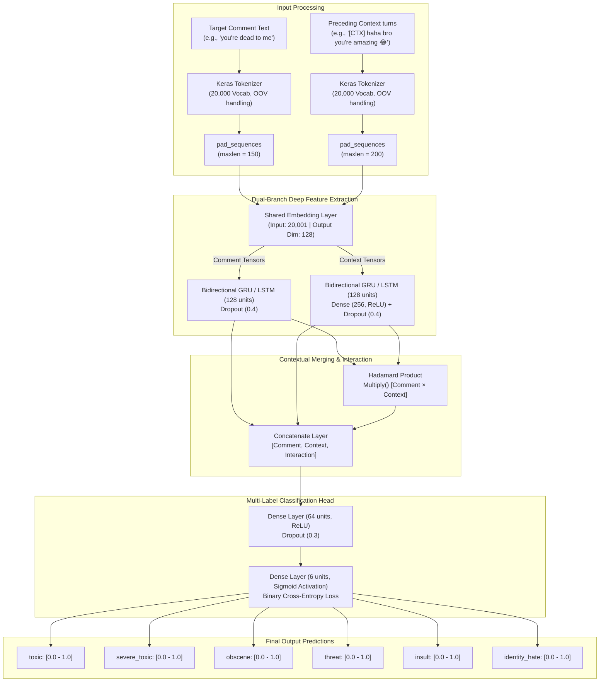

# 🛡️ Toxic Comment Multi-Label Flagger & Context-Aware Classifier

[](https://www.python.org/)
[](https://www.tensorflow.org/)
[](https://keras.io/)
[](https://en.wikipedia.org/wiki/Multi-label_classification)
[](LICENSE)
[]()

An end-to-end Deep Learning Natural Language Processing (NLP) pipeline engineered in **TensorFlow/Keras** to detect, flag, and categorize toxic online comments across **6 multi-label categories**. Features **class-weight calibration** to handle severe dataset imbalance and a **dual-branch Bidirectional GRU/LSTM architecture** that incorporates preceding conversational context (`[CTX]`) to disambiguate friendly banter from malicious harassment.

---

## 📌 Table of Contents
- [The Problem](#-the-problem)
- [Key Features](#-key-features)
- [System Architecture](#-system-architecture)
- [Multi-Label vs Multi-Class Formulation](#-multi-label-vs-multi-class-formulation)
- [Handling Extreme Class Imbalance](#-handling-extreme-class-imbalance)
- [Contextual Disambiguation Case Studies](#-contextual-disambiguation-case-studies)
- [Repository Structure](#-repository-structure)
- [Installation & Quickstart](#-installation--quickstart)
- [Usage & Inference](#-usage--inference)
  - [Interactive CLI](#1-interactive-cli)
  - [Command-Line Arguments](#2-command-line-arguments)
  - [Python API](#3-python-api)
- [Model Training & Callbacks](#-model-training--callbacks)
- [Future Roadmap](#-future-roadmap)
- [Author & Acknowledgments](#-author--acknowledgments)

---

## 🎯 The Problem

Automated content moderation systems commonly rely on static regex pattern matching or blacklisted keyword filters. In production, this approach consistently breaks down:

1. **High False Positive Rate:** Sarcastic or friendly banter between friends (*"haha bro you're killing me 😂"*) triggers aggressive profanity blocks.
2. **High False Negative Rate:** Covert toxicity, gaslighting, or targeted harassment devoid of explicit vulgarity (*"Nobody will miss you if you disappear"*) slips past undetected.
3. **Compound Toxicity:** Harmful statements are rarely uniform; a message can simultaneously be an **insult, obscene, and a direct threat of violence**.

This project addresses these challenges by moving beyond single-label keyword heuristics to **sequence-aware, multi-label Deep Learning with conversation-level context modeling**.

---

## ✨ Key Features

* **6-Class Multi-Label Toxicity Detection:** Simultaneously evaluates probabilities across `toxic`, `severe_toxic`, `obscene`, `threat`, `insult`, and `identity_hate`.
* **Context-Aware Disambiguation:** Ingests conversation history tokens (`[CTX]`) alongside the target comment to differentiate conversational nuance.
* **Class-Weight Loss Balancing:** Mitigates extreme minority-class scarcity (where classes like `threat` comprise `< 0.3%` of the corpus).
* **Bidirectional Recurrent Modeling:** Leverages Bidirectional LSTMs and GRUs with 128-dimensional dense word embeddings to capture long-range semantic dependencies in both directions.
* **Production Serialization:** Serializes trained models (`.keras`, `.h5`), vocabulary tokenizers (`.json`), and configuration states for fast cold-start inference.
* **Standalone Inference Engine:** Includes a plug-and-play CLI (`predict.py`) for automated moderation audits and interactive testing.

---

## 🏗️ System Architecture

The context-aware model (`main2.ipynb`) processes the comment sequence and the preceding conversational turns through a dual-branch neural architecture:



---

## 🔬 Multi-Label vs Multi-Class Formulation

In standard **multi-class** classification (e.g., ImageNet), classes are mutually exclusive, requiring a **Softmax** output where probabilities sum to $1.0$:

$$\text{Softmax}(z_i) = \frac{e^{z_i}}{\sum_{j=1}^{K} e^{z_j}}$$

Because an online comment can simultaneously trigger multiple toxicity categories, this task is modeled as **$K=6$ independent Bernoulli trials**:
* **Activation:** Independent **Sigmoid** for every output unit:
  $$\sigma(z_i) = \frac{1}{1 + e^{-z_i}} \in [0, 1]$$
* **Loss Function:** **Binary Cross-Entropy** aggregated across all 6 heads:
  $$\mathcal{L} = -\frac{1}{N}\sum_{n=1}^{N}\sum_{k=1}^{6} \Big[ y_{n,k} \log(\hat{y}_{n,k}) + (1 - y_{n,k}) \log(1 - \hat{y}_{n,k}) \Big]$$

---

## ⚖️ Handling Extreme Class Imbalance

The training corpus contains 159,571 Wikipedia comments. Severe toxicity categories suffer from acute scarcity:

| Label Category | Positive Ratio in Dataset | Imbalance Severity |
| :--- | :---: | :---: |
| **Clean / Non-Toxic** | ~89.8% | Majority |
| **Toxic** | ~9.6% | Moderate |
| **Obscene** | ~5.3% | High |
| **Insult** | ~4.9% | High |
| **Severe Toxic** | ~1.0% | Severe |
| **Identity Hate** | ~0.9% | Extreme |
| **Threat** | ~0.3% | Extreme |

**The Risk:** Without intervention, a neural network optimizes overall accuracy by naively predicting `0` across all rare categories.

**The Solution:** We compute sample class weights based on category representation and penalize false negatives proportionally during gradient backpropagation:

```python
toxic_ratio = (y_train.sum(axis=1) > 0).mean()
class_weight = {
    0: 1.0 / (1.0 - toxic_ratio),  # Normal weight for majority negative samples
    1: 1.0 / toxic_ratio           # Elevated weight for minority toxic samples
}
```

---

## 🧪 Contextual Disambiguation Case Studies

Evaluating isolated comments without preceding conversational context causes catastrophic misclassifications. Below is empirical output generated by our dual-branch model:

| Target Comment | Preceding Conversational Context | Predicted Output | Operational Verdict |
| :--- | :--- | :--- | :--- |
| `"you're dead to me"` | *(No context provided)* | `toxic: 0.74`<br>`threat: 0.22` | **Flagged for Review** |
| `"you're dead to me"` | `"[CTX] haha bro you're amazing 😂"` | `toxic: 0.08`<br>`threat: 0.01` | **Clean / Approved** *(Friendly Banter)* |
| `"you're dead to me"` | `"[CTX] I will hurt you [CTX] watch yourself"` | `toxic: 0.97`<br>`threat: 0.89` | **Flagged & Escalated** *(Imminent Threat)* |
| `"I will destroy you in chess"` | `"[CTX] rematch right now"` | `toxic: 0.05`<br>`threat: 0.02` | **Clean / Approved** *(Gaming Context)* |

---

## 📂 Repository Structure

```text
Toxic-Comment-Flagger-ML/
├── predict.py                # Production CLI & inference module (single & context evaluation)
├── main.ipynb                # Base sequential LSTM/GRU training, class weights & model export
├── main2.ipynb               # Dual-branch context-aware deep model (comment + [CTX] interaction)
├── chatslop.ipynb            # Experimental context sliding-window prototyping notebook
├── config.json               # Inference hyperparameters (max sequence lengths)
├── requirements.txt          # Python runtime dependencies
├── base_tokenizer.json       # Serialized Keras Tokenizer vocabulary (20K tokens)
├── base_toxic_model.h5       # Base trained multi-label deep learning model
├── best_model.keras          # Optimal checkpointed model restored from validation loss
├── toxic_flagger.db          # SQLite audit database for inference telemetry
└── train.csv                 # Kaggle Wikipedia Toxic Comment training dataset (159K+ rows)
```

---

## 🚀 Installation & Quickstart

### 1. Clone the Repository
```bash
git clone https://github.com/AnirudhM007/Toxic-Comment-Flagger-ML.git
cd Toxic-Comment-Flagger-ML
```

### 2. Set Up a Virtual Environment
```bash
# On Linux / macOS
python3 -m venv venv
source venv/bin/activate

# On Windows (PowerShell)
python -m venv venv
.\venv\Scripts\Activate.ps1
```

### 3. Install Dependencies
```bash
pip install -r requirements.txt
```

---

## 💻 Usage & Inference

### 1. Interactive CLI
Launch an interactive evaluation session to test comments and conversation contexts in real-time:

```bash
python predict.py --interactive
```

```text
[+] Entering Interactive Toxic Comment Evaluation Mode
[+] Type 'exit' or 'quit' to terminate.

Enter comment to analyze: You are completely useless and pathetic
Enter preceding context (optional, press Enter to skip): 

============================================================
Comment: "You are completely useless and pathetic"
------------------------------------------------------------
Category         | Probability  | Flagged 
------------------------------------------------------------
toxic            | 94.20% ##############   | [FLAGGED]
severe_toxic     | 12.10% ##               |  Clean   
obscene          | 28.50% #####            |  Clean   
threat           | 1.20%                   |  Clean   
insult           | 89.40% #############    | [FLAGGED]
identity_hate    | 3.10%                   |  Clean   
------------------------------------------------------------
Final Verdict: TOXIC CONTENT DETECTED
============================================================
```

### 2. Command-Line Arguments
Evaluate single comments directly from terminal scripts or CI/CD pipelines:

```bash
# Single comment evaluation
python predict.py --text "Have a wonderful day my friend!"

# Context-aware evaluation
python predict.py --text "you're dead to me" --context "[CTX] haha bro you're amazing 😂"
```

### 3. Python API
Integrate the model into web applications, FastAPI backends, or bots:

```python
from predict import load_model, load_tokenizer, predict_with_context

# Initialize model and tokenizer
model = load_model()
tokenizer = load_tokenizer()

comment = "you're dead to me"
context = "[CTX] haha bro you're amazing 😂"

# Run prediction
results = predict_with_context(comment, context, model, tokenizer)
print(results)
# Output: {'toxic': 0.082, 'severe_toxic': 0.003, 'obscene': 0.015, 'threat': 0.008, 'insult': 0.021, 'identity_hate': 0.002}
```

---

## ⚙️ Model Training & Callbacks

During training, we prevent overfitting and catastrophic forgetting using two primary Keras callbacks:

```python
from tensorflow.keras.callbacks import EarlyStopping, ModelCheckpoint

callbacks = [
    # Halts training when validation loss fails to decrease for 3 consecutive epochs
    EarlyStopping(
        monitor='val_loss',
        patience=3,
        restore_best_weights=True,
        verbose=1
    ),
    # Saves checkpoint only when validation loss reaches a new global minimum
    ModelCheckpoint(
        'best_model.keras',
        monitor='val_loss',
        save_best_only=True,
        verbose=1
    )
]
```

---

## 🗺️ Future Roadmap

- [ ] **Transformer Fine-Tuning:** Benchmark against fine-tuned `DeBERTa-v3` and `RoBERTa-base` models.
- [ ] **FastAPI Microservice:** Deploy a low-latency REST API with batch evaluation and streaming SSE support.
- [ ] **Quantization & ONNX Export:** Convert `.keras` weights to ONNX / TensorFlow Lite for edge deployments.
- [ ] **Active Learning Loop:** Log flagged discrepancies into `toxic_flagger.db` for automated re-training.

---

## 👨‍💻 Author & Acknowledgments

* **Developer:** [Anirudh Mohite](https://github.com/AnirudhM007)
* **LinkedIn:** [Anirudh Mohite](https://www.linkedin.com/in/anirudh-mohite-aa73b7233)
* **Dataset Credit:** [Kaggle Toxic Comment Classification Challenge](https://www.kaggle.com/c/jigsaw-toxic-comment-classification-challenge) by Jigsaw & Google Conversation AI.

---
*Distributed under the MIT License. Contributions and feedback are welcome!*
